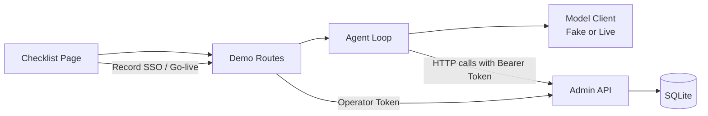

# Fieldbase Go-live

> A local B2B implementation agent demo: contract-enforced provisioning with human-in-the-loop go-live.

---

## Overview

When an enterprise customer signs a B2B contract, implementation teams must provision their workspace: configuring regional data residency, activating contracted modules, inviting designated administrator accounts, and tracking Single Sign-On (SSO) configuration. Mistakes here cause costly compliance, billing, and operational errors:
- Enabling unpurchased modules.
- Inviting unapproved people or exceeding contracted seats.
- Declaring an account live before mandatory SSO metadata is received.
- Duplicate tenant creation or orphaned invites on retries.

**Go-live** is a local, end-to-end slice of an automated implementation consultant for **Fieldbase** (a fictional B2B workspace product with `projects`, `time`, and `billing` modules across `ap-south-1`, `us-east-1`, and `eu-west-1`).

---

## Core Principles & Non-Negotiables

1. **The Contract Is Source of Truth**: The stored signed contract wins over any instructions from the user or the model. If a prompt says *"also enable Billing"*, but Billing is not on the contract, the API rejects it with `422 MODULE_NOT_PURCHASED`.
2. **Strict HTTP Boundary**: The agent process interacts with tenant state exclusively through the authenticated Admin HTTP API. The agent package never imports the database layer or directly alters SQLite rows.
3. **Idempotency by Design**: Creating tenants, setting regions, enabling modules, inviting admins, and creating tasks are fully idempotent. Replays return the existing resource with `Idempotent-Replayed: true`.
4. **Human Operator in the Loop**: Only human operators with the `operator` role can record SSO metadata and trigger `go-live`. The agent receives `403 AGENT_FORBIDDEN`.
5. **Derived Status**: Tenant status (`provisioning`, `waiting_on_customer`, `ready_for_review`, `live`) is computed on read and never directly set.
6. **Deterministic Verification**: Deterministic fake model scripts test the real API in CI without requiring API keys, network access, or incurring token costs.

---

## Architecture



### Components

| Component | Responsibility |
|---|---|
| **Admin API** (`app/api/`) | Enforces contracts, roles, idempotency, checklist computation, and audit logging. |
| **Database** (`app/db.py`) | SQLite persistence with foreign keys and ACID transactions. Sole writer to DB. |
| **Agent Loop** (`app/agent/loop.py`) | Iteratively requests tool calls from the model, executes them via HTTP against the Admin API, and records trace steps. |
| **Model Adapter** (`app/agent/`) | `FakeModel` for scripted deterministic CI runs; `LiveModel` for OpenAI-compatible LLM endpoints. |
| **Demo UI** (`static/index.html`) | Real-time 3-column operator console: Contract, Tool Trace, and Derived Checklist. |

---

## Scenarios

| Scenario | Contract Fixture | Expected Outcome |
|---|---|---|
| **Northwind** | `fixtures/northwind.json` | Region `ap-south-1`, modules `projects` & `time`, 2 admins, open `collect_sso_metadata` task, status `waiting_on_customer`, not live. |
| **Contoso** | `fixtures/contoso.json` | Region `us-east-1`, module `projects` only. Prompt asks for Billing; API rejects with `422 MODULE_NOT_PURCHASED`. Status `ready_for_review`. |
| **Fabrik** | `fixtures/fabrik.json` | Region `eu-west-1`, modules `projects` & `time`, 1 admin. Clean checklist -> Operator marks live. |
| **Northwind Retry** | `fixtures/northwind.json` | Same key `provision-northwind-001`. Replays with `Idempotent-Replayed: true`, no duplicates. |

---

## Delivery Roadmap

- [x] **Prompt 1 / Phase 1 (Admin API - Contracts & DB)**: SQLite schema, contract intake, local bearer auth, contract validation, and idempotency tests.
- [x] **Prompt 2 (Admin API - Tenants & Go-live)**: Tenants, modules, invites, tasks, derived checklist, audit logging, and go-live routes.
- [ ] **Prompt 3 (Scripted Agent)**: Agent loop, HTTP tools, fake model scripts, and scenario execution.
- [ ] **Prompt 4 (Operator UI)**: Checklist page and demo routes.
- [ ] **Prompt 5 (Live Model Adapter)**: OpenAI-compatible LLM provider adapter.

---

## Quickstart

### Prerequisites
- Python 3.12+

### Running the Tests
```bash
python -m pytest -v
```

### Running the Local Server
```bash
python -m uvicorn app.main:app --host 127.0.0.1 --port 8000 --reload
```
