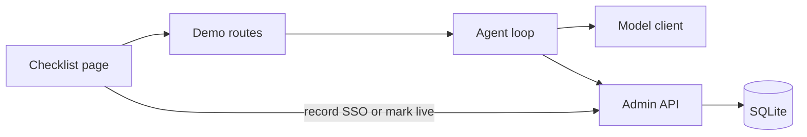
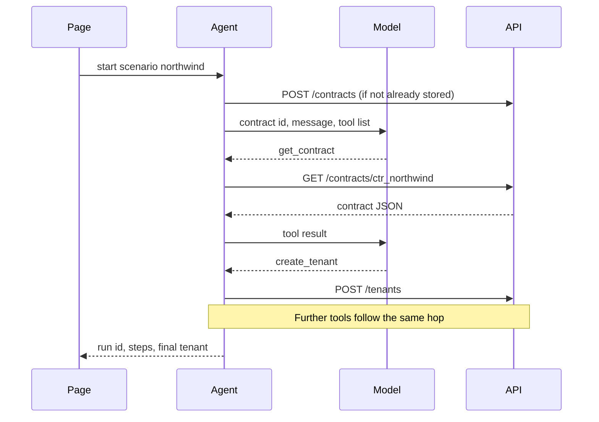

# 02 — Architecture

## Components



| Piece | Responsibility |
|---|---|
| Admin API | Stores contracts and tenants. Enforces the contract, roles, and idempotency. Derives status and checklist |
| Agent loop | Asks the model for one tool call at a time, performs that call as HTTP against the admin API, appends the result, stops on a finish signal or the step limit |
| Model client | `FakeModel` returns the scripted next call. `LiveModel` calls a provider. Both return the same shape |
| Demo routes | Start a scenario with the agent token held on the server. The browser never receives either token |
| Checklist page | Renders the contract, the trace, and the checklist. Operator buttons call demo routes that use the operator token server-side |
| SQLite | One file, created on startup, gitignored |

There is one process. The HTTP boundary between the agent loop and the admin API is still real: the agent uses an HTTP client and the base URL, the same way it would call another service. See [ADR 0001](adr/0001-http-boundary.md).

## Trust

| Data | Trust |
|---|---|
| Fixture contract after intake | Authoritative for seats, modules, region, admins, and the SSO requirement |
| User message on a scenario | Instructions to the model only. Contoso's Billing sentence does not change the contract |
| Model tool arguments | Untrusted input to the API. The API checks them |
| Tool error body | Trusted description of what the API did. The model does not get to overrule it |
| Operator token | May record SSO metadata and mark live |
| Agent token | Provisioning tools only |

The page is not a trusted place to hide a token. Tokens stay in server memory, loaded from the environment.

## Provisioning flow



Each hop is one tool. The model does not receive a batch of results it did not ask for, and the loop does not skip the API because the script "already knows" the outcome. The fake model chooses the call. The API performs it.

## Roles

Local tokens, used only when `APP_ENV=local`:

| Env var | Default in local only | Role |
|---|---|---|
| `AGENT_TOKEN` | `agent-local` | `agent` |
| `OPERATOR_TOKEN` | `operator-local` | `operator` |

Missing bearer: `401`. Unknown bearer: `401`. A route that exists but is outside the role: `403 AGENT_FORBIDDEN` for the agent token. These defaults must not be described as production authentication.

## Runs and audit

Every admin API call writes an `audit_events` row: time, actor role, method, path, HTTP status, error code if any, request JSON, response JSON, and `run_id` when the caller passes `X-Run-Id`.

The agent loop creates a `runs` row first and sends that run id on every tool call. The page reads steps from `run_steps` and can also show the matching audit rows. A tool call that the API rejected is a successful HTTP conversation with an error code, and it is stored. It is not a crashed run.

## Process layout

```
go-live/
  app/
    main.py              # FastAPI app, static files, demo routes
    api/                 # admin routes and auth
    domain/              # checklist, status, policies
    db.py                # SQLite access used by the API only
    agent/loop.py        # tool loop
    agent/fake_model.py  # scripts from docs/05-agent.md
    agent/live_model.py  # provider adapter
    agent/http_tools.py  # urllib or httpx calls to the admin API
  fixtures/              # canonical JSON, already in the repo
  static/index.html
  tests/
```

`agent/http_tools.py` is the only module in `agent/` that speaks HTTP. `domain/` and `db.py` are imported by `api/`, not by `agent/`. An architecture test fails if `app/agent` imports `app.db` or `app.domain`.

## Failure behavior

- A tool error is appended to the transcript. The loop continues until the model stops or the step limit is hit.
- The step limit is 12. Hitting it ends the run with `stopped_reason: step_limit` and still returns the tenant as it is.
- The fake scripts finish in fewer than 12 steps.
- A live provider timeout is a failed step with code `MODEL_ERROR`. It does not mark the tenant live and does not invent a tool result.
- Unhandled exceptions in a request return a problem body. They do not leave a half-written invite. Each write uses a SQLite transaction.

## v1 runtime

One command serves the API and the page on `127.0.0.1`. SQLite path defaults to `./go-live.db`. Tests use a temporary database file or an in-memory connection per test, never the developer's `go-live.db`.
